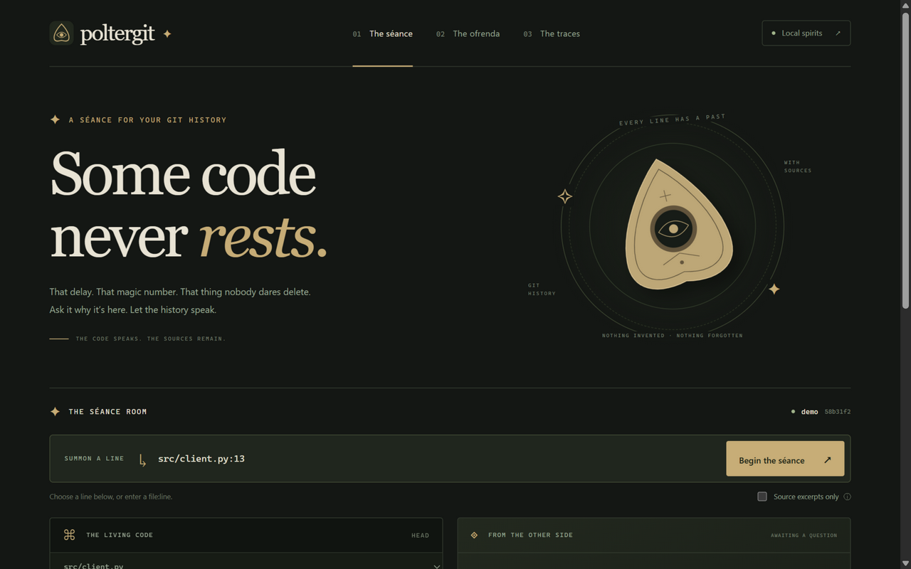
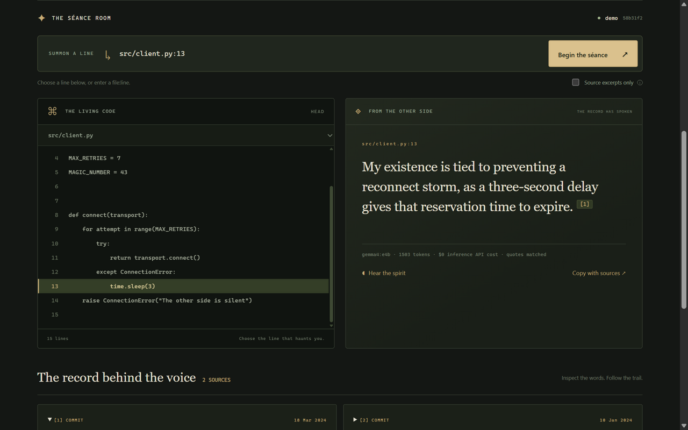
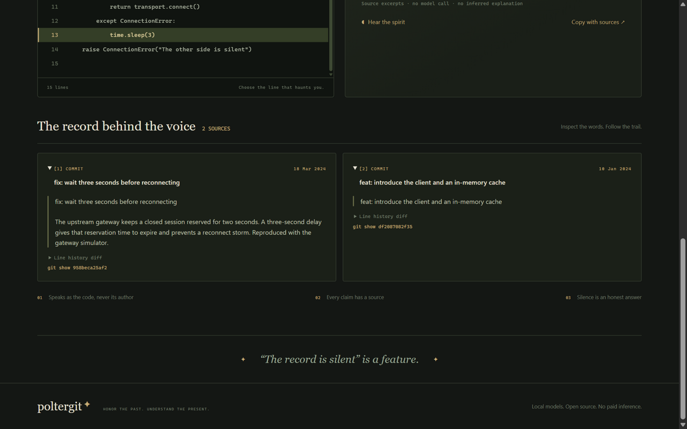
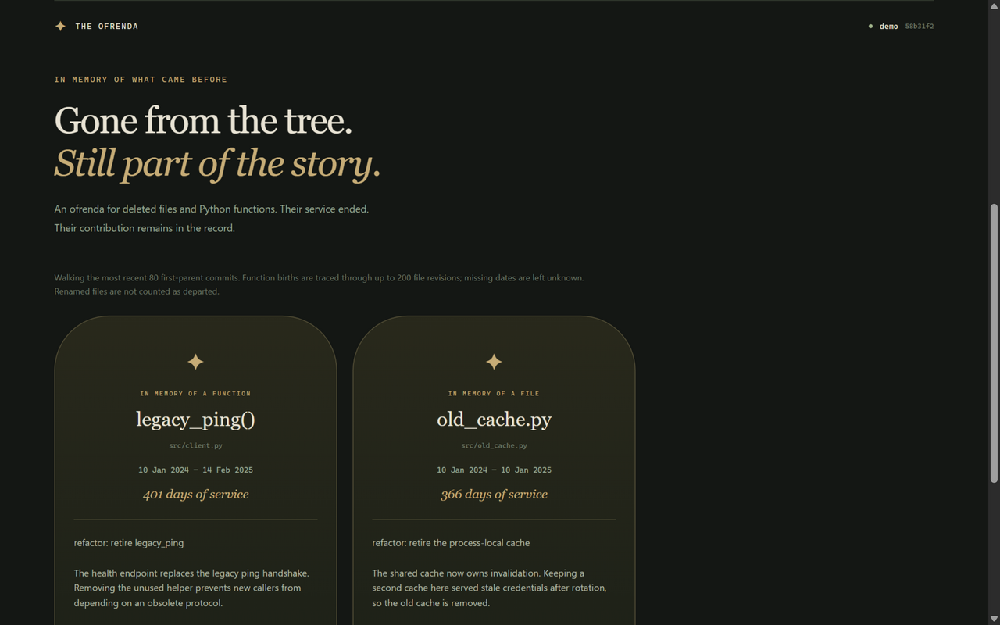

<p align="center">
  
</p>

<h3 align="center">Poltergit</h3>

<p align="center">
  <b>A séance for your git history. Every ghost brings receipts.</b>
</p>

<p align="center">
  An open-source tool that asks any line of code why it exists — and answers in the line's own voice,<br>
  citing the commits, diffs and discussions behind it. Where the record is silent, it says so.<br>
  It all runs on your own laptop.
</p>

<p align="center">
  <a href="https://github.com/CodeNeuron58/Poltergit/actions/workflows/tests.yml"></a>
  
  
  <a href="https://dev.to/code_neuron58/poltergit-i-held-a-seance-with-a-line-of-code-and-it-told-me-why-it-exists-57bh"></a>
</p>

<p align="center">
  <a href="https://youtu.be/mfBNnNZ7Z2I"></a><br>
  <sub>▶ <a href="https://youtu.be/mfBNnNZ7Z2I">Watch the 44-second demo</a></sub>
</p>

## How it works

<table>
  <tr>
    <td width="33%" valign="top"></td>
    <td width="33%" valign="top"></td>
    <td width="33%" valign="top"></td>
  </tr>
  <tr>
    <td valign="top"><b>1 · Summon</b><br>Point at any line. Poltergit walks its history with <code>git log -L</code> — the commits, the diffs, the discussions around them.</td>
    <td valign="top"><b>2 · The line speaks</b><br>Gemma answers in first person — as the code, never its author — with a citation attached to every claim.</td>
    <td valign="top"><b>3 · The receipts</b><br>Every claim must quote its source exactly, or the answer is discarded and labeled excerpts are shown instead.</td>
  </tr>
</table>

## When the record is silent

<p align="center">
  
</p>

Silence is a feature, not a failure. A magic number changed by a commit titled "update"? *The record is silent.*
No invented intent, no guessed reasons — the same honesty as a historian's "not stated".

And for code that has passed on, <b>poltergit ofrenda</b> builds a Día de los Muertos memorial: every deleted
file and function gets an obituary — when it was added, how long it served, and the commit that retired it.

## Built with

| Open-source piece | What it does |
|---|---|
| **Gemma 4 E4B** | Writes the answers, locally through Ollama — structured JSON, temperature 0.15 |
| **EmbeddingGemma** | Turns history into 768-dimension vectors for retrieval |
| **Tiger Data · pgvector** | Hybrid keyword + vector search that finds the evidence line history alone misses |
| **Kokoro** | Reads the answer aloud in a séance-room echo, entirely on ONNX |
| **Sentry** | Traces every séance: history walk, hybrid search, model call, verification |
| **FastAPI · Typer · Jinja2** | The local web séance, CLI, and the ofrenda export |

## What the record shows

| | Without hybrid search | With Tiger Data + pgvector |
|---|:---:|:---:|
| A retry loop whose only commit says "introduce the client" | *The record is silent* | **"I exist to tolerate the gateway maintenance window, as seven attempts cover the gateway's eighteen-second maintenance window…"** — cited |

Every generated citation is checked verbatim against its source before you see it. In live testing, one
fabricated citation was caught and discarded — the séance fell back to the original commit text, clearly labeled.
Every run is traced end to end: the git walk, the database search, the model call with its token counts, and the
verification step — at <b>$0.00 inference cost</b>.

<details>
<summary><b>Run it locally</b></summary>

<br>

Git, Python 3.12+, [uv](https://docs.astral.sh/uv/) and [Ollama](https://ollama.com) with `gemma4:e4b` and `embeddinggemma`.

```powershell
uv sync
uv run poltergit doctor          # every local component reports ready
uv run poltergit demo            # create the fictional demo repository
uv run poltergit why src/client.py:13 --repo .poltergit/demo --record
uv run poltergit serve --repo .poltergit/demo --record   # http://127.0.0.1:8787
uv run poltergit ofrenda --repo .poltergit/demo --output site
uv run pytest
```

Drop `--record` to let Gemma answer (set `POLTERGIT_TIMEOUT=600` on CPU-only machines — answers take
two to three minutes without a GPU). Optional integrations go in `.env`: `POLTERGIT_DATABASE_URL` for
hybrid search, `POLTERGIT_SENTRY_DSN` for tracing, `POLTERGIT_GITHUB=true` for PR and issue retrieval.
Full setup: **[docs/SETUP.md](docs/SETUP.md)**

</details>

<details>
<summary><b>Acknowledgments</b></summary>

<br>

The demo repository is fictional, clearly labeled, and contacts no real service. The séance reads committed
`HEAD` only, sends nothing to the cloud, and never impersonates a developer. Entire was considered for the
agent-session category and intentionally omitted.

</details>

---

<p align="center">
  <sub>Honor the past. Understand the present. 🕯️</sub>
</p>
